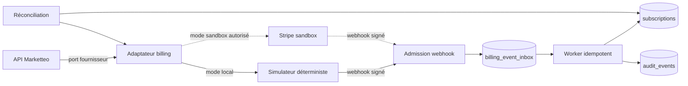

# Phase 5.3 — Contrat du simulateur de paiement et des webhooks

| Métadonnée | Valeur |
| --- | --- |
| Produit | Marketteo CRM |
| Version | 1.0 — contrat de conception approuvé |
| Date | 9 octobre 2026 |
| Mode autorisé | Local déterministe et Stripe sandbox uniquement |
| Effet financier | Aucun |

## 1. But et frontières

Le simulateur prouve le cycle d'abonnement, les erreurs fournisseur, les signatures, le rejeu, l'ordre des événements
et la réconciliation sans argent, sans carte, sans email réel et sans connexion à un fournisseur externe. Il doit
permettre une recette reproductible sur Docker local et dans le pipeline.

Le simulateur ne reproduit pas toute l'API Stripe. Il n'est ni un serveur de développement général, ni un mécanisme de
secours en production, ni une source de vérité commerciale. Son contrat est fermé et limité aux opérations P5.3.

## 2. Architecture retenue



Trois modes fermés sont prévus :

| Mode | Réseau fournisseur | Effet financier | Usage |
| --- | --- | --- | --- |
| `disabled` | Interdit | Aucun | Valeur par défaut, production incluse tant qu'aucun GO réel n'existe |
| `simulated` | Réseau Docker privé uniquement | Aucun | Tests automatisés et recette locale |
| `stripe_sandbox` | Stripe sandbox uniquement | Aucun argent réel | Validation contractuelle de l'adaptateur |

Le futur mode réel n'est pas une valeur P5.3 autorisée. Son ajout exigera une décision de mise en service distincte.

## 3. Port fournisseur sortant

Le domaine dépend d'un port fournisseur minimal, jamais du SDK Stripe directement :

```text
create_checkout(command, idempotency_key) -> checkout_reference + expires_at
create_portal_session(customer_reference, return_target, idempotency_key) -> portal_reference + expires_at
get_subscription(provider_subscription_id) -> normalized_subscription_snapshot
list_events(cursor, occurred_from, occurred_to) -> normalized_event_page
refund_first_payment(command, idempotency_key) -> normalized_refund
```

Règles :

- toute mutation sortante porte une clé d'idempotence générée et persistée côté serveur ;
- le montant, la devise, le cycle et la référence de prix proviennent de la version P5.2 publiée ;
- la correction locale `P53-06B` doit couvrir CAD, USD, EUR et XAF sans conversion et vérifier la cohérence de la
  devise et de la référence simulée sur tout le parcours ; ses critères figurent dans la section 15.1 des
  [spécifications P5.3](./PHASE_5_3_SPECIFICATIONS_DETAILLEES.md#151-p53-06b--checkout-simulé-pour-quatre-devises) ;
- les références externes sont opaques et ne sont jamais acceptées comme autorité depuis le navigateur ;
- seules les destinations de retour appartenant à une liste serveur sont acceptées ;
- les URL checkout/portail ne sont renvoyées qu'une fois, avec `Cache-Control: no-store`, et ne sont pas journalisées ;
- timeout, retry et circuit breaker sont bornés ; un résultat inconnu déclenche une réconciliation, jamais un second
  effet aveugle.

## 4. API fermée du simulateur

Le service Docker privé expose uniquement :

| Méthode | Route | Effet déterministe |
| --- | --- | --- |
| `POST` | `/v1/checkout/sessions` | Crée ou rejoue une session selon la clé d'idempotence. |
| `POST` | `/v1/portal/sessions` | Crée une URL opaque locale à durée bornée. |
| `GET` | `/v1/subscriptions/{id}` | Retourne le snapshot fournisseur courant. |
| `GET` | `/v1/events` | Retourne une page ordonnée d'événements normalisés. |
| `POST` | `/v1/refunds` | Simule un remboursement autorisé ou un refus stable. |
| `POST` | `/__control/scenarios/{code}` | Injecte un scénario de test depuis le réseau QA uniquement. |

Les contrôles `__control` exigent un secret de test distinct, ne sont jamais routés par le proxy public et font
échouer le démarrage hors environnement `local` ou `test`.

### 4.1 Scénarios injectables

| Code | Résultat |
| --- | --- |
| `checkout_completed` | Checkout terminé sans activer à lui seul l'abonnement. |
| `invoice_paid` | Paiement confirmé ; abonnement activable. |
| `invoice_payment_failed` | Passage à `past_due`, puis grâce. |
| `subscription_cancel_scheduled` | Annulation enregistrée à la fin de période. |
| `subscription_canceled` | Fin de période confirmée et état `canceled`. |
| `payment_recovered` | Retour à `active` depuis `past_due`, `grace_period` ou `suspended`. |
| `refund_succeeded` | Remboursement manuel confirmé sans détruire l'historique. |
| `duplicate_event` | Même `event_id` et même corps livrés plusieurs fois. |
| `event_id_collision` | Même `event_id` avec un corps différent ; incident de sécurité. |
| `stale_event` | Événement antérieur livré après un état plus récent. |
| `invalid_signature` | Signature incorrecte. |
| `expired_signature` | Horodatage hors tolérance. |
| `provider_timeout_before_effect` | Aucun effet fournisseur ; retry permis avec la même clé. |
| `provider_timeout_after_effect` | Effet possible mais réponse perdue ; réconciliation obligatoire. |
| `provider_unavailable` | Refus fermé avec code stable et aucun nouvel effet. |

## 5. Contrat de signature webhook

Le simulateur reproduit la sémantique d'une signature horodatée :

```text
signed_payload = timestamp + "." + raw_body
signature = HMAC-SHA256(webhook_secret, signed_payload)
header = "t=<unix>,v1=<hex-signature>"
```

Le vérificateur :

1. reçoit le corps brut avant toute désérialisation ;
2. exige `application/json` et une taille maximale de 64 KiB ;
3. refuse un horodatage situé à plus de 300 secondes de l'horloge serveur ;
4. compare en temps constant une signature `v1` à un secret courant ou précédent ;
5. refuse les champs ou types d'événements hors registre ;
6. calcule un SHA-256 du corps et n'inscrit aucun payload dans les journaux ;
7. persiste l'enveloppe normalisée avant de répondre `2xx`.

Les secrets local, sandbox et futur réel sont différents. La rotation autorise le secret précédent pendant 24 heures
au maximum, avec début et fin de chevauchement audités.

## 6. Admission durable et déduplication

La table `billing_event_inbox` possède au minimum :

- `id`, `provider`, `provider_event_id` et contrainte unique `(provider, provider_event_id)` ;
- `event_type`, `provider_object_id`, `provider_created_at`, `received_at` ;
- `payload_digest`, `signature_version`, `api_version` ;
- enveloppe normalisée bornée, sans carte, URL, adresse complète ou texte libre ;
- `status` parmi `admitted`, `processing`, `processed`, `dead_letter`, `ignored` ;
- compteurs, prochaine tentative, code d'erreur stable et horodatages de traitement.

Réponses HTTP :

| Situation | Réponse | Effet |
| --- | --- | --- |
| Signature invalide/expirée | `400` | Aucune écriture métier ; compteur sécurité seulement. |
| Type ou schéma inconnu | `422` | Aucun effet ; alerte de contrat. |
| Premier événement valide | `202` | Admission durable, traitement asynchrone. |
| Doublon identique | `200` | Aucun nouvel effet. |
| Identifiant identique, digest différent | `409` | Incident, aucun effet, file de quarantaine. |
| Stockage indisponible | `503` | Pas d'accusé de réception positif ; le fournisseur peut retenter. |

## 7. Traitement idempotent et ordre

Le worker traite chaque événement dans une transaction comprenant projection d'abonnement, événement métier et audit.
La clé d'effet unique est `(provider, provider_event_id, effect_code)`.

Un événement n'est appliqué que si :

- il cible l'organisation déjà liée à la référence fournisseur ;
- sa transition appartient à la machine d'états fermée ;
- son instant effectif et sa version ne régressent pas l'état courant ;
- la version de prix locale est publiée et compatible avec la devise fournisseur ;
- aucune référence n'appartient à un autre tenant.

Un événement retardé ou ambigu passe en `ignored` ou `needs_reconciliation`. Il ne rétablit jamais un plan, une période
ou un droit ancien sur la seule base de son ordre d'arrivée.

Les tentatives sont bornées à 8 avec backoff exponentiel et jitter. Une erreur permanente ou l'épuisement place
l'événement en `dead_letter`, déclenche une alerte et conserve une commande de rejeu manuelle auditée.

## 8. Registre d'événements normalisés

| Événement normalisé | Source attendue | Autorité locale |
| --- | --- | --- |
| `checkout.completed` | Checkout achevé | Lie les références ; ne rend pas `active`. |
| `subscription.snapshot` | Création/mise à jour/annulation fournisseur | Met à jour période, annulation prévue et statut si non régressif. |
| `invoice.paid` | Paiement confirmé | Peut activer/réactiver la période exacte. |
| `invoice.payment_failed` | Paiement échoué | Passe à `past_due` et initialise la politique de grâce. |
| `refund.succeeded` | Remboursement autorisé | Enregistre le remboursement ; l'accès suit la politique contractuelle validée. |

Le nom exact des événements Stripe est traduit dans l'adaptateur. Le domaine et les migrations ne dépendent pas de
chaînes Stripe.

## 9. Réconciliation

Trois chemins sont requis :

- incrémental toutes les 15 minutes pour `pending_checkout`, `past_due`, `grace_period`, `canceling` et événements en
  erreur ;
- exhaustif quotidien pour toutes les souscriptions non terminales ;
- manuel, limité à une organisation ou référence, avec capacité plateforme et justification.

La réconciliation compare identifiants, prix, devise, statut, période et annulation. Elle classe chaque différence :
`in_sync`, `local_stale`, `provider_stale`, `mapping_missing`, `currency_mismatch`, `price_mismatch`, `unresolved`.
Elle peut corriger `local_stale` dans une transaction auditée ; les autres différences restent bloquées pour examen.

## 10. Preuves minimales

| ID | Preuve |
| --- | --- |
| `P53-SIM-01` | Même commande et même clé donnent une seule session ; corps différent avec même clé est refusé. |
| `P53-WEB-01` | Signature valide admise, signature fausse/ancienne refusée sans effet. |
| `P53-WEB-02` | Cent livraisons du même événement produisent un effet et un audit métier. |
| `P53-WEB-03` | Événement ancien après paiement récent ne régresse pas l'abonnement. |
| `P53-WEB-04` | Collision d'identifiant avec digest différent est mise en quarantaine. |
| `P53-REC-01` | Timeout après effet est résolu par réconciliation sans deuxième checkout. |
| `P53-REC-02` | Divergence de devise ou de prix n'est jamais corrigée automatiquement. |
| `P53-SEC-01` | Aucun secret, URL, corps brut ou donnée bancaire dans logs, audits, erreurs et JUnit. |
| `P53-NOEXT-01` | Le mode simulé ne résout aucun DNS public et n'émet aucun email ou paiement. |

## 11. Conditions de sortie du simulateur

Le simulateur est accepté lorsque toutes les preuves sont vertes sur base Docker neuve, sans skip, avec temps contrôlé,
fixtures synthétiques, horloge injectable, absence d'effet externe et rapport archivé. Cette acceptation permet le
passage à Stripe sandbox ; elle n'autorise toujours pas le mode réel.
