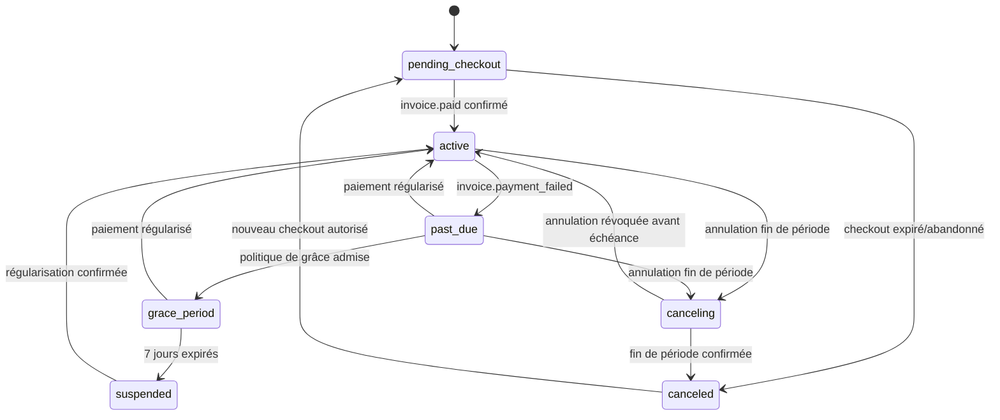

# Phase 5.3 — Abonnement et fournisseur de paiement

| Métadonnée | Valeur |
| --- | --- |
| Produit | Marketteo CRM |
| Phase | 5.3 — Abonnement et fournisseur de paiement |
| Version | 0.1 — analyse détaillée et périmètre approuvés |
| Date | 9 octobre 2026 |
| Mise à jour des devises | 21 octobre 2026 — confirmation du commanditaire |
| Statut | Développement local/simulateur et Stripe sandbox autorisé ; aucun paiement réel |
| Décisions | [Registre P5.3](./PHASE_5_3_DECISIONS.md) |
| Simulateur | [Contrat simulateur et webhooks](./PHASE_5_3_SIMULATEUR_PAIEMENT_WEBHOOKS.md) |
| Dépendances | P5.2 validée, catalogue/version/droits, contrats internes, sièges, RLS, audit, worker durable |
| Frontière | Abonnement, projection fournisseur, checkout/portail hébergés, webhooks et réconciliation ; pas d'UX générale P5.4 ni d'activation réelle |

## 1. Résultat recherché

P5.3 transforme le contrat interne P5.2 en cycle d'abonnement réconciliable avec un fournisseur, sans confier au
navigateur l'autorité sur un montant, un état ou un droit. Le lot doit démontrer avec un simulateur déterministe, puis
avec Stripe sandbox, qu'un abonnement peut être créé, payé, échouer, entrer en grâce, être suspendu, annulé et
réconcilié sans double effet ni fuite inter-tenant.

Le résultat attendu est un **GO technique de sandbox**, pas un GO de paiement réel. La mise en service reste bloquée
par les signatures Finance, Juridique, Sécurité et Exploitation du registre de décisions.

## 2. Analyse de l'existant et écarts

| Sujet | Existant P5.2 | Écart P5.3 |
| --- | --- | --- |
| Catalogue | Versions immuables, devise, cycle, montant synthétique, droits | Références Stripe sandbox et matrice commerciale signée à l'avenir |
| Contrat | `organization_plan_contracts` interne et manuel | Souscription fournisseur distincte et projection réconciliée |
| Droits | Calcul déterministe sous RLS | Source abonnement intégrée sans contourner les quatre couches P5.2 |
| Sièges | Réservation et acceptation atomiques | Blocage des changements incompatibles avec l'usage courant |
| Audit | Append-only et métadonnées fermées | Événements paiement minimisés, sans montant détaillé ni payload brut |
| Worker | Jobs durables, claim atomique, retries bornés | Traitement webhook, grâce, réconciliation et dead-letter billing |
| API | Vue catalogue/contrat interne minimale | Checkout/portail internes et endpoint webhook signé |
| Fournisseur | Aucun | Port fournisseur, simulateur, Stripe sandbox, kill switch |
| Fiscalité | Montants HT synthétiques, aucune taxe | Codes fiscaux/configuration validés avant mode réel |

Le principal risque architectural est la coexistence de deux vérités : le fournisseur porte l'état financier, tandis
que Marketteo porte le contrat d'accès et les droits. P5.3 résout ce risque par une projection locale versionnée,
idempotente, monotone et réconciliable. Le navigateur n'est jamais une troisième source d'autorité.

**Écart de lancement multidevise :** CAD est la devise de référence et CAD, USD, EUR et XAF doivent être
commercialisables dès le lancement. Le catalogue reconnaît les quatre devises, mais les fonctions de préparation et
de finalisation du checkout introduites par la migration `20261010_0054` imposent encore CAD. Une évolution additive
et des tests de bout en bout pour chaque devise sont donc nécessaires avant de déclarer les quatre parcours prêts.
Les prix, territoires, règles fiscales et la compatibilité fournisseur restent à valider pour chaque devise ;
cette cible ne constitue pas une autorisation de paiement réel.

## 3. Périmètre

### 3.1 Inclus

- port fournisseur indépendant du SDK Stripe ;
- simulateur de paiement déterministe sans réseau public ;
- adaptateur Stripe sandbox derrière un kill switch ;
- clients fournisseurs et souscriptions liés à une organisation ;
- création idempotente de checkout et portail hébergés ;
- admission durable de webhooks signés ;
- traitement asynchrone, déduplication, ordre et dead-letter ;
- cycle `pending_checkout`, `active`, `past_due`, `grace_period`, `suspended`, `canceling`, `canceled` ;
- politique de grâce de 7 jours et annulation en fin de période ;
- remboursement manuel borné et simulé ;
- réconciliation incrémentale, exhaustive et manuelle ;
- RLS, capacités plateforme/tenant, version optimiste et audit minimal ;
- tests locaux, PostgreSQL/Redis réels, concurrence et preuves sans effet externe.

### 3.2 Exclus

- paiement, remboursement ou email réel ;
- données bancaires, saisie de carte ou stockage PCI dans Marketteo ;
- publication de prix commerciaux définitifs ou activation commerciale réelle de CAD, USD, EUR ou XAF ;
- essai payant, coupon libre, prorata automatique, facturation à l'usage ou siège additionnel ;
- inscription publique et création autonome d'organisation ;
- changement de plan libre-service et écrans Compte/Administration complets ;
- application générale des droits à toutes les routes CRM, réservée à P5.4 ;
- avis fiscal ou juridique, dépôt de déclaration ou tenue de comptabilité ;
- mode Stripe réel ou cohorte cliente.

## 4. Principes non négociables

1. **Le serveur choisit le prix.** Le client fournit un code/intention autorisé ; la version publiée, la devise, le
   cycle et la référence fournisseur sont relus côté serveur.
2. **La redirection ne confirme rien.** Seul un webhook valide ou une réconciliation autorisée modifie l'état.
3. **L'admission précède l'accusé.** Aucun `2xx` positif avant persistance durable d'un événement vérifié.
4. **Un événement, un effet.** Les doublons, retries, redémarrages et concurrences ne produisent pas un second effet.
5. **L'ordre d'arrivée n'est pas l'ordre métier.** Toute transition est vérifiée par date/version et réconciliation.
6. **Le fournisseur financier ne remplace pas P5.2.** Les droits effectifs continuent de passer par le moteur P5.2.
7. **La panne ferme le payant.** Un état indéterminable bloque checkout et opérations coûteuses, mais conserve les
   lectures de récupération autorisées.
8. **Le tenant est dérivé côté serveur.** Aucune organisation du corps client n'autorise une lecture ou une mutation.
9. **Les données sont minimales.** Aucun PAN, CVC, payload brut, URL de portail ou secret dans logs, audit ou API.
10. **Le réel est impossible par défaut.** Configuration, schéma d'environnement et kill switch doivent l'interdire.

## 5. Modèle de données cible

Les migrations sont additives. Les noms exacts pourront être ajustés pendant l'implémentation, mais les responsabilités
et invariants suivants sont obligatoires.

| Entité | Portée | Responsabilité | Invariants principaux |
| --- | --- | --- | --- |
| `billing_customers` | tenant | Lien organisation ↔ client fournisseur | Un client courant par organisation/fournisseur ; références opaques ; RLS. |
| `subscriptions` | tenant | Projection locale d'une souscription fournisseur | Une souscription courante non terminale par organisation ; plan/version/devise cohérents ; version optimiste. |
| `subscription_transitions` | tenant | Historique métier append-only | Ancien/nouvel état, cause fermée, événement source, sans texte libre sensible. |
| `billing_commands` | tenant | Idempotence des checkout, portail et remboursement | Clé + empreinte uniques ; résultat minimal ; conflit si corps différent. |
| `billing_event_inbox` | plateforme cloisonnée | Admission durable des webhooks | `(provider,event_id)` unique ; digest immuable ; statut fermé ; pas de payload brut dans les logs. |
| `billing_events` | tenant | Événement normalisé applicable | Référence à l'inbox ; organisation résolue côté serveur ; schéma versionné. |
| `billing_reconciliation_runs` | plateforme/tenant | Exécution et résumé de comparaison | Fenêtre, curseur, compteurs, statut, sans snapshot sensible. |
| `billing_reconciliation_differences` | tenant | Différence nécessitant correction ou revue | Code fermé, références opaques, résolution auditée. |
| `billing_refunds` | tenant | Projection d'une demande/remboursement | Premier paiement seulement en V1, décision manuelle, idempotence, état fournisseur. |

### 5.1 Relations avec P5.2

- `subscriptions.organization_id` référence l'organisation, protégée par RLS ;
- `subscriptions.plan_version_id` référence une version publiée immuable ;
- `organization_plan_contracts` reste le contrat d'accès consommé par le moteur P5.2 ;
- une transition financière confirmée met à jour ou programme le contrat dans la même transaction que l'audit ;
- une divergence financière ne modifie jamais directement `plan_entitlements` ou une version publiée ;
- une dérogation P5.2 reste distincte d'un remboursement ou d'une correction fournisseur.

### 5.2 Contraintes minimales

- index unique partiel sur la souscription courante d'une organisation ;
- clés étrangères composites incluant `organization_id` pour empêcher les croisements tenant ;
- période `current_period_end > current_period_start` ;
- devise identique entre souscription, version de plan et référence fournisseur ;
- dates UTC et horloge serveur uniquement ;
- états, causes et types d'événement issus de registres fermés ;
- aucun `ON DELETE CASCADE` susceptible d'effacer l'historique financier/audit ;
- rôle Web sans accès direct aux tables inbox/réconciliation globales ;
- fonctions `SECURITY DEFINER` à `search_path` fixé, propriétaire dédié et privilèges minimaux.

## 6. Machine d'états

Règles complémentaires :

- `checkout.completed` ne suffit pas pour passer à `active` ;
- `active` exige une période payée ou une activation explicitement autorisée par une future décision ;
- le timer local peut passer `past_due` à `grace_period`, puis demander la suspension, mais une réconciliation confirme
  l'état fournisseur avant toute réactivation ;
- `suspended` ne détruit ni membres, ni prospects, ni exports historiques ;
- le statut fournisseur inconnu ou contradictoire produit `billing_state_unknown` et ferme les opérations payantes ;
- un remboursement n'est pas implicitement une annulation : la politique approuvée décide de l'accès restant.

## 7. Architecture applicative

### 7.1 Ports

Le domaine expose des contrats séparés :

- `BillingProviderGateway` pour les commandes sortantes et snapshots ;
- `BillingWebhookVerifier` pour signature et normalisation ;
- `BillingEventInbox` pour admission/déduplication ;
- `SubscriptionRepository` sous RLS ;
- `BillingCommandRepository` pour l'idempotence ;
- `BillingReconciliationGateway` pour curseurs et différences ;
- `TransactionalAuditRecorder` existant pour l'audit atomique ;
- `Clock` injectée pour grâce, signatures et tests.

Le domaine ne dépend ni de Stripe, ni de HTTP, ni d'un SDK fournisseur.

### 7.2 Adaptateurs

- `simulated` implémente le contrat fermé décrit dans le document simulateur ;
- `stripe_sandbox` traduit les objets Stripe en événements normalisés ;
- `disabled` refuse toute commande avec `billing_provider_disabled` ;
- aucun fallback automatique du sandbox/réel vers le simulateur n'est permis ;
- une panne Redis ne remplace jamais l'idempotence durable PostgreSQL des commandes financières.

## 8. API P5.3 limitée

P5.3 fournit les contrats backend nécessaires à la preuve. L'expérience complète demeure P5.4.

| Méthode | Route | Autorisation | Réponse minimale |
| --- | --- | --- | --- |
| `POST` | `/api/billing/checkout-session` | membre actif + `billing:manage` + CSRF + session récente | URL opaque et expiration seulement |
| `POST` | `/api/billing/portal-session` | membre actif + `billing:manage` + CSRF + session récente | URL opaque et expiration seulement |
| `GET` | `/api/billing/subscription` | membre actif + capacité de lecture | état, plan/version, période, annulation prévue ; aucune référence fournisseur |
| `POST` | `/api/billing/webhooks/stripe` | signature fournisseur ; sans cookie ni CSRF | accusé d'admission générique |
| `POST` | `/api/platform/billing/reconcile` | administrateur plateforme + justification + CSRF | identifiant de run et état |
| `POST` | `/api/platform/billing/refunds` | administrateur plateforme + approbation/justification + CSRF | état de demande et code stable |

Exigences :

- `Cache-Control: no-store` sur toute réponse billing ;
- `Idempotency-Key` obligatoire sur les mutations utilisateur/plateforme ;
- version optimiste sur les opérations modifiant une projection existante ;
- aucune URL de retour arbitraire ;
- aucune réponse ne révèle `customer_id`, `subscription_id`, `price_id`, `event_id` fournisseur ou secret ;
- erreurs `403`, `409`, `422`, `429`, `503` distinguées par codes stables sans message fournisseur.

## 9. Codes d'erreur fermés

| Code | HTTP | Sens |
| --- | --- | --- |
| `billing_capability_required` | `403` | Capacité ou session récente absente. |
| `billing_provider_disabled` | `503` | Mode fournisseur interdit par configuration. |
| `billing_provider_unavailable` | `503` | Fournisseur indisponible ; état non déduit. |
| `billing_catalog_version_unavailable` | `422` | Version non publiée, retirée ou non commercialisable. |
| `billing_currency_unavailable` | `422` | Devise non autorisée commercialement. |
| `billing_seat_limit_conflict` | `422` | Changement incompatible avec sièges utilisés/réservés. |
| `billing_command_conflict` | `409` | Clé d'idempotence réutilisée avec un autre corps. |
| `billing_version_conflict` | `409` | Projection modifiée concurremment. |
| `billing_subscription_exists` | `409` | Une souscription non terminale existe déjà. |
| `billing_webhook_invalid` | `400` | Signature, horodatage ou contenu invalide. |
| `billing_webhook_unsupported` | `422` | Type ou version non supporté. |
| `billing_event_collision` | `409` | Identifiant fournisseur déjà vu avec un autre digest. |
| `billing_state_unknown` | `503` | État local/fournisseur indéterminable ; fermeture contrôlée. |
| `billing_refund_not_eligible` | `422` | Politique V1 ou état fournisseur incompatible. |
| `billing_reconciliation_required` | `409` | Effet possible mais résultat inconnu. |

## 10. Sécurité, RLS et confidentialité

- les tables tenant appliquent `ENABLE` et `FORCE ROW LEVEL SECURITY` ;
- l'organisation courante provient du contexte de session serveur ;
- les références fournisseur d'un autre tenant produisent un refus indistinguable ;
- le rôle applicatif n'accède à l'inbox que par fonctions étroites ;
- le endpoint webhook possède débit, taille, type de contenu et horodatage bornés ;
- le corps brut n'est jamais inclus dans une exception, métrique, audit ou trace ;
- les URL checkout/portail sont traitées comme secrets éphémères ;
- les secrets sont fournis par gestionnaire, séparés par environnement et redacted dans `repr` ;
- les réponses et audits n'exposent pas l'adresse de facturation complète ou l'identifiant fiscal ;
- les sauvegardes et exports sont inspectés pour absence de données bancaires ;
- l'API Stripe est épinglée à une version explicite et toute évolution passe une recette de contrat.

## 11. Audit et observabilité

### 11.1 Actions auditées

- checkout demandé/admis/refusé ;
- portail demandé ;
- transition d'abonnement appliquée/ignorée ;
- grâce commencée/expirée ;
- annulation programmée/révoquée/confirmée ;
- remboursement demandé/approuvé/refusé/confirmé ;
- réconciliation lancée, divergence détectée et correction appliquée ;
- dead-letter rejouée ou abandonnée ;
- rotation de secret et changement de mode fournisseur.

Les métadonnées utilisent uniquement des codes fermés, identifiants internes, version, ancien/nouvel état et booléens.
Montant détaillé, email, adresse, justification libre, URL et référence fournisseur sont interdits dans l'audit.

### 11.2 Métriques

- admissions webhook par résultat et type normalisé ;
- doublons, collisions, signatures invalides et événements hors ordre ;
- latence admission → traitement P50/P95/P99 ;
- profondeur/âge inbox et dead-letter ;
- commandes fournisseur, timeout avant/après effet et circuit breaker ;
- souscriptions par état et grâce proche d'expiration ;
- runs/différences de réconciliation par code ;
- taux d'erreur sans étiquette tenant, email ou identifiant externe.

## 12. Fiscalité, comptabilité et juridique

P5.3 implémente des points de configuration, pas une règle fiscale autonome :

- le prix catalogue reste hors taxes ;
- le code fiscal, l'inscription, le lieu de fourniture et le traitement B2B/B2C sont validés hors code ;
- la facture légale est hébergée/fournie par Stripe ; Marketteo expose un lien éphémère via portail, pas une copie ;
- tout remboursement conserve sa trace fournisseur et son traitement fiscal ;
- les registres doivent permettre à Finance de rapprocher période, devise, total et statut sans stocker de carte ;
- les CGU, la confidentialité, l'annulation, la grâce et le remboursement existent en `fr-CA` et `en-CA` avant le réel.

## 13. Pannes et retour arrière

| Panne | Comportement exigé |
| --- | --- |
| Fournisseur indisponible avant effet | Refus `503`, retry avec la même clé. |
| Timeout après effet possible | État `unknown`, aucune répétition aveugle, réconciliation. |
| PostgreSQL indisponible à l'admission | Pas de `2xx`; fournisseur invité à retenter. |
| Redis indisponible | Pas de perte d'idempotence durable ; débit protégé ou fermeture contrôlée. |
| Worker arrêté | Inbox accumulée, reprise sans double effet. |
| Secret webhook compromis | Kill switch, rotation, double secret borné, rejeu/reconciliation. |
| Événement non supporté | Aucun effet, alerte contrat, évolution explicite. |
| Régression applicative | Ancienne application relue sans downgrade destructif ; événements restent durables. |
| Simulateur accidentel hors test | Démarrage refusé. |

Le rollback applicatif désactive les nouvelles commandes fournisseur mais continue d'admettre les webhooks valides si
le schéma reste compatible. Les migrations suivent expand/migrate/contract ; aucun downgrade ne supprime événements,
souscriptions ou audits.

## 14. Scénarios d'acceptation P5.3

| ID | Priorité | Scénario | Preuve attendue |
| --- | --- | --- | --- |
| `P53-CAT-01` | P0 | Client falsifie montant/devise/référence | Aucun appel fournisseur ; version serveur seule autorité. |
| `P53-CHK-01` | P0 | Deux checkout identiques concurrents | Une session fournisseur, un résultat durable. |
| `P53-CHK-02` | P0 | Timeout après création fournisseur | Aucun second checkout ; réconciliation retrouve le premier. |
| `P53-WEB-01` | P0 | Signature fausse, ancienne ou corps modifié | Refus avant écriture métier. |
| `P53-WEB-02` | P0 | Webhook livré cent fois et après restart | Un effet et un audit métier. |
| `P53-WEB-03` | P0 | Événements retardés/hors ordre | Aucune régression ; réconciliation si ambigu. |
| `P53-SUB-01` | P0 | Paiement confirmé | `active`, période exacte, contrat P5.2 cohérent. |
| `P53-SUB-02` | P0 | Échec, grâce 7 jours, suspension, régularisation | Transitions déterministes sans suppression de donnée. |
| `P53-CAN-01` | P0 | Annulation puis révocation avant échéance | Accès conservé ; états confirmés par fournisseur. |
| `P53-CAN-02` | P0 | Annulation arrivée à échéance | `canceled`, aucun nouvel effet payant. |
| `P53-REF-01` | P0 | Remboursement non éligible ou doublé | Refus stable ou rejeu ; jamais deux remboursements. |
| `P53-REC-01` | P0 | Projection locale divergente | Différence classée et correction auditée ou bloquée. |
| `P53-RLS-01` | P0 | Référence d'un autre tenant | Refus sans existence révélée. |
| `P53-SEC-01` | P0 | Inspecter logs/audits/erreurs/sauvegarde | Aucune carte, secret, URL ou payload brut. |
| `P53-NOEXT-01` | P0 | Recette en mode simulé | Aucun DNS public, email ou effet financier. |
| `P53-SBX-01` | P1 | Rejouer le contrat en Stripe sandbox | Parité des événements normalisés et zéro argent réel. |

## 15. Plan de livraison

| Étape | Priorité | Objet | Sortie démontrable |
| --- | --- | --- | --- |
| `P53-01` | P0 | Registres domaine, ports et codes fermés | Tests unitaires des états, transitions et erreurs. |
| `P53-02` | P0 | Schéma abonnement/inbox/commandes et RLS | Migration additive, rollback jetable, ACL/RLS prouvés. |
| `P53-03` | P0 | Simulateur et adaptateur `disabled/simulated` | Scénarios déterministes, aucun réseau public. |
| `P53-04` | P0 | Admission webhook signée | Corps brut, signature, taille, temps, déduplication et collision. |
| `P53-05` | P0 | Worker de projection et cycle d'abonnement | Transaction, audit, ordre, retry, dead-letter et restart. |
| `P53-06` | P0 | Checkout/portail internes idempotents | Prix serveur, URL opaque, session récente et no-store. |
| `P53-07` | P0 | Grâce, annulation et remboursement simulé | Timers, transitions, approbation et absence de double effet. |
| `P53-06B` | P0 | Correction multidevise du checkout simulé | Quatre devises cohérentes, migration additive, retour arrière sûr et recette ci-dessous. |
| `P53-08` | P0 | Réconciliation | Incrémentale, exhaustive, manuelle et différences classées. |
| `P53-09` | P1 | Adaptateur Stripe sandbox | API épinglée, traduction normalisée, secrets et contrat. |
| `P53-10` | P1 | Preuves et recette synthétique | Matrice, JUnit sans skip, absence de données sensibles/effet externe. |

La correction `P53-06B` complète `P53-06` ; elle précède `P53-08` pour que la réconciliation soit conçue
avec les quatre devises. `P53-09` ne commence qu'après validation du simulateur et disponibilité de secrets sandbox
dédiés. Aucun travail de mode réel n'appartient à ce plan.

**État communiqué par le commanditaire :** P53-01 à P53-07 sont présents dans le dépôt. Pour `P53-06B`, le verrou
qualité local a été rapporté vert sur l'état final testé, avec 44 parcours navigateur contrôlés et axe PASS. Le
commit `75d1fdf` ne contient qu'une partie des éléments : la migration `20261021_0056`, le script du verrou et les
documents concernés nécessitent un commit complémentaire. Ce résultat ne valide ni fournisseur réel,
ni mise en préproduction ou en production. `P53-08` reste à préparer et n'est pas autorisé par ce verdict.

### 15.1 `P53-06B` — checkout simulé pour quatre devises

**Décision produit déjà prise :** CAD est la devise de référence ; CAD, USD, EUR et XAF doivent être
commercialisables dès le lancement. Ce lot prépare les quatre parcours **en simulation locale uniquement** : il ne
publie pas de prix réels et n'active ni fournisseur réel, ni facture réelle, ni client externe.

**Constat technique :** le catalogue et la souscription reconnaissent les quatre codes ; la migration
`20261010_0054` limite à CAD `app_private.prepare_billing_checkout` et `app_private.complete_billing_checkout`.
La référence `sim_price_…` est aujourd'hui construite à partir de l'identifiant de version de plan : elle est
strictement fictive et ne constitue pas une référence ou une preuve de compatibilité Stripe.

**Périmètre validé :**

1. Créer une migration Alembic additive après la révision courante, sans réécrire `20261010_0054` déjà livrée.
   Adapter les deux fonctions pour accepter seulement CAD, USD, EUR et XAF et préserver leurs signatures, leurs
   contrôles de tenant, rôle, statut, sièges, idempotence, audit, privilèges et `search_path` sécurisé.
2. Garder la version publiée de catalogue comme source serveur de la devise et du prix simulé ; le navigateur ne
   choisit ni montant ni référence fournisseur. Refuser un code inconnu et toute réponse fournisseur dont la devise,
   la version ou la référence de prix ne correspondent pas à la commande autorisée, sans écriture partielle.
3. Propager la devise inchangée dans la commande, la session simulée et la souscription. Vérifier également le
   traitement d'un webhook simulé cohérent et le refus d'une divergence, sans considérer la redirection checkout
   comme une confirmation de paiement. Ne créer aucune conversion, aucun prix dérivé ni calcul fiscal.
4. Préserver les comportements de rejeu, concurrence et état inconnu ; tester le lien entre la commande réservée et
   les données de finalisation pour éviter qu'un rejeu ou une substitution de version ne change de devise.
5. Maintenir l'adaptateur `simulated` et le mode désactivé : aucune autorisation Stripe sandbox ou réelle n'est donnée
   par ce lot. Les codes monétaires, unités mineures, montants et contraintes exactes du fournisseur réel seront
   vérifiés séparément avant son intégration ; la prise en charge de XAF ne doit pas être supposée.

**Retour arrière :** le downgrade restaure les fonctions CAD de la révision précédente, y compris leurs permissions,
et ne supprime ni ne convertit de données. Il doit refuser explicitement le retour arrière si des données ou commandes
non-CAD rendent ce retour incompatible, et expliquer la condition ; la stratégie précise de traitement des commandes
en cours sera prouvée pendant l'implémentation. Tests upgrade/downgrade uniquement sur base jetable avec données
fictives ; aucun effacement de données d'un environnement partagé n'est autorisé.

**Recette minimale à réaliser :**

| ID | Scénario | Résultat attendu |
| --- | --- | --- |
| `P53-MC-01` | Checkout simulé pour chaque devise | La version, la commande, le résultat et la souscription conservent exactement CAD, USD, EUR ou XAF ; CAD ne régresse pas. |
| `P53-MC-02` | Devise inconnue, version non publiée ou expirée | Refus contrôlé ; aucun appel fournisseur ni écriture métier partielle pour une nouvelle commande. |
| `P53-MC-03` | Devise, prix ou version incohérents en finalisation | Refus fermé ; aucun changement de souscription ou commande validée à tort. |
| `P53-MC-04` | Deux demandes identiques, puis même clé avec autre version/devise | Un seul effet pour le rejeu ; conflit pour l'intention modifiée, sans effet supplémentaire. |
| `P53-MC-05` | Webhooks simulés concordants et discordants | Traitement conforme au cycle existant ; divergence refusée ou isolée sans activation indue. |
| `P53-MC-06` | Tenant incorrect, rôle insuffisant, session non récente | Refus sans fuite inter-tenant ni appel fournisseur. |
| `P53-MC-07` | Migration, rollback compatible et rollback incompatible | Upgrade et downgrade sur base jetable ; refus sûr si le retour CAD rendrait l'état incohérent. |
| `P53-MC-08` | Vérifications PostgreSQL réel et verrou complet | Tests ciblés sans skip, ACL/RLS/audit préservés, puis verrou vert ; traces sans secret ni effet externe. |

**Condition de lancement commercial, hors de ce lot :** grilles HT signées pour chaque devise et chaque offre/cycle
concerné, validation fiscale et territoriale, factures HT/taxes/TTC, compatibilité du fournisseur, preuves sandbox,
et autorisation de mise en service. Les réserves P5.1 et Porte 4 restent inchangées.

## 16. Definition of Ready

- décisions `P53-D01` à `P53-D18` confirmées ;
- P5.2 verrou vert et révision Alembic de départ identifiée ;
- contrat du simulateur approuvé ;
- responsables Produit, Architecture et Sécurité identifiés pour la recette locale ;
- prix réels, taxes, secrets sandbox et entité vendeuse explicitement exclus des fixtures locales ;
- aucune réserve P5.1/Porte 4 déclarée levée implicitement.

## 17. Definition of Done technique P5.3

- migrations, RLS, ACL, immutabilité et rollback jetable prouvés ;
- simulateur déterministe et mode `disabled` couverts sans réseau public ;
- checkout, portail et commandes financières idempotents sous concurrence/restart ;
- webhooks signés, dupliqués, falsifiés, anciens et hors ordre testés ;
- grâce, suspension, annulation, remboursement et réconciliation audités ;
- aucune carte, secret, URL, payload brut ou PII superflue dans artefacts observables ;
- verrou qualité complet vert sans skip avec PostgreSQL/Redis/simulateur réels ;
- recette Stripe sandbox archivée si les secrets ont été autorisés ;
- kill switch activé et paiement réel toujours impossible.

La Definition of Done technique ne vaut pas mise en service. Les portes de décision du registre P5.3 restent
obligatoires avant toute organisation cliente ou transaction réelle.

## 18. Réserves actives

- entité vendeuse et contrat Stripe non signés dans le dépôt ;
- configuration GST/HST, codes fiscaux et factures non validés par Finance/Juridique ;
- grilles de prix commerciaux HT CAD, USD, EUR et XAF non fournies ;
- parcours de paiement multidevise local à valider sur son état final, et compatibilité fournisseur, territoires et fiscalité
  de chaque devise à valider avant le lancement ;
- textes contractuels et politique de remboursement bilingues non signés ;
- secrets Stripe sandbox/réel absents et non requis pour le socle local ;
- P5.1 opérationnelle, P5.4, P5.5 et GO de mise en service encore séparés.
